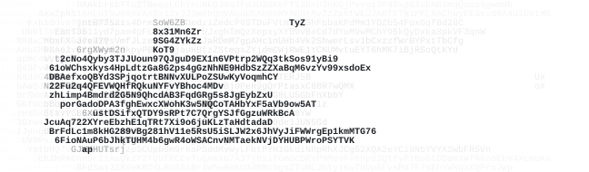

  <picture>
    <source media="(prefers-color-scheme: dark)" srcset="assets/shiva-dark.svg">
    
  </picture>
   
  full-stack product engineer · open to work
   
  <samp><a href="https://shiva66.xyz">shiva66.xyz</a> / <a href="https://x.com/Neutron975">x</a> / <a href="mailto:shivaset2@gmail.com">email</a> / <a href="https://shiva66.xyz/shiva_seth.pdf">resume</a></samp>

 

i take products from 0→1. two years of freelancing for early teams, lately building ai agents and apps on solana. 
<samp>rust · typescript · anchor · next.js · postgres · helius</samp>

<samp><b>$ ls work</b></samp>

<samp><b><a href="https://belzin.vercel.app">belzin</a></b></samp> · p2p betting inside a group chat, run by an ai agent · [$3,000 solana foundation grant](https://github.com/user-attachments/assets/f16719c8-6017-4a42-a6da-11f8b8b445b7) 
<samp><b><a href="https://traderdraft.vercel.app">traderdraft</a></b></samp> · a fantasy-style game where top solana traders become tradable tokens 
<samp><b><a href="https://gibbon-cli.vercel.app">gibbon</a></b></samp> · terraform-style plan and apply for gibwork bounties 
<samp><b><a href="https://univault.xyz">univault</a></b></samp> · run a squads multisig from a single blink · [blinkathon winner, squads track](https://x.com/thesendcoin/status/1839324398102409634)

<samp><b>$ ls experience</b></samp>

[glympsedotfun](https://x.com/glympsedotfun) · product engineering and protocol dev · <samp>aug – nov 2025</samp> 
[send arcade](https://www.sendarcade.fun) · on-chain games in rust and anchor · <samp>feb – apr 2025</samp> 
[superteam india](https://superteam.fun) · member, technical help for bounty hunters · <samp>jan 2025 – now</samp> 
[freelance](https://earn.superteam.fun/t/shiva7343/) · solana programs and dapps for clients · <samp>jul 2024 – now</samp>

<samp><b>$ ls open-source</b></samp>

merged prs in anchor, zcash, discord.js, meshery, lucide and superteam earn · [all prs](https://github.com/search?q=is%3Apr+author%3AShiva953+is%3Amerged&type=pullrequests) 
<samp>[anchor#2752](https://github.com/otter-sec/anchor/pull/2752) ts: add IDL seed types</samp> 
<samp>[zcash#303](https://github.com/zcashlabs/thus-spoke-zakura/pull/303) feat(cli): add wallet quote command</samp> 
<samp>[discord.js#9345](https://github.com/discordjs/discord.js/pull/9345) feat!: return entries instead of values in toJSON</samp>

